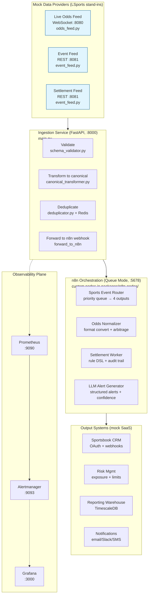

# 02_architecture.md

# Architecture — Sports Data Automation Platform

**Audience:** the learner. **How to use:** read after 01_business_context.md. This doc explains
the components, data flow, main-use-case sequence, trust boundaries, state, and what scales.

> 📌 Sections marked **[INFERENCE]** are deduced from the repo, not explicitly stated.

---

## 1. System diagram (Mermaid)



## 2. Components (and where each lives)

| Component | Responsibility | Key file(s) |
|-----------|---------------|-------------|
| Mock Odds Feed | WebSocket server pushing randomized odds every 500ms–2s | packages/mock-providers/src/mock/odds_feed.py |
| Mock Event Feed | REST /events + /settlements with pagination & /simulate | packages/mock-providers/src/mock/event_feed.py |
| Ingestion Service | Validate → Transform → Deduplicate → Forward to n8n | packages/ingestion-service/src/ingestion/main.py |
| SchemaValidator | JSON Schema (Draft 7) validation per type | .../normalization/schema_validator.py |
| CanonicalTransformer | Provider→canonical field mapping, odds→decimal | .../normalization/canonical_transformer.py |
| Deduplicator | Redis SET NX EX idempotency (24h TTL) | .../idempotency/deduplicator.py |
| SportsEventRouter | Content-based priority routing, 4 outputs | packages/n8n-nodes/.../SportsEventRouter.node.ts |
| OddsNormalizer | Format conversion, implied probability, arbitrage | packages/n8n-nodes/.../OddsNormalizer.node.ts |
| SettlementWorker | Rule-DSL evaluation, confidence, audit trail | packages/n8n-nodes/.../SettlementWorker.node.ts |
| LLMAlertGenerator | LLM-structured alerts, confidence, human review | packages/n8n-nodes/.../LLMAlertGenerator.node.ts |
| Prometheus | Scrape /metrics, rule evaluation | monitoring/prometheus/prometheus.yml + rules/*.yml |
| Alertmanager | Tiered routing (pager/warning/business/info) | monitoring/prometheus/alerts/alertmanager.yml |
| Grafana | Business + system dashboards | monitoring/grafana/dashboards/*.json |
| Canonical types (TS+Python) | Single source-of-truth data contract | packages/canonical-types/src/types.ts + .../types.py |

## 3. Data flow (main use case: an odds update)

1. **MockOddsFeed** generates a random odds update (provider_0, evt_000001, match_winner/home,
   American format) and pushes it over WebSocket every 500ms–2s
   (odds_feed.py:_generate_odds_update / _broadcast_loop).
2. **WebSocketClient** (ingestion) receives the JSON, reconnects with backoff on drop
   (websocket_client.py).
3. **handle_odds_message → process_odds** runs validate → transform → deduplicate → forward
   (main.py:process_odds).
4. **SchemaValidator** rejects malformed payloads (schema_validator.py:validate).
5. **CanonicalTransformer** maps provider fields to canonical + converts American→decimal
   (canonical_transformer.py:transform_odds / _normalize_odds).
6. **Deduplicator** does SET NX EX on `odds:{providerId}:{eventId}:{sequence}`; duplicates dropped
   (deduplicator.py:check_and_store).
7. **forward_to_n8n** POSTs to `http://n8n:5678/webhook/odds` (main.py:forward_to_n8n).
8. **n8n SportsEventRouter** routes by priority (high/normal/low/dead-letter)
   (SportsEventRouter.node.ts:execute).
9. **n8n OddsNormalizer** converts to output format, computes implied probability, flags arbitrage
   + best odds (OddsNormalizer.node.ts:execute).
10. Downstream (mock) CRM / Risk / Reporting consume the normalized odds.

## 4. Sequence diagram: settlement of an ended match

```mermaid
sequenceDiagram
    participant EF as Event Feed (mock)
    participant IS as Ingestion Service
    participant N8N as n8n + SettlementWorker
    participant CRM as Sportsbook CRM
    EF->>IS: POST /ingest/settlement {eventId, outcome=won, ...}
    IS->>IS: validate (schema_validator)
    IS->>IS: transform (canonical_transformer → decimal, outcome)
    IS->>IS: dedup (Redis SET NX EX)
    IS->>N8N: webhook /webhook/settlement
    N8N->>N8N: evaluate Rule DSL (highest-priority match)
    N8N->>N8N: confidence = f(priority); >= threshold?
    alt auto-settle
        N8N->>CRM: notify bet settled (won)
        N8N-->>IS: 200 processed
    else human review
        N8N-->>N8N: Pending Review output
        note right of N8N: ops reviews audit trail
    end
```

## 5. Trust boundaries

| Boundary | What crosses | Protection |
|----------|-------------|------------|
| Provider → Ingestion | Raw JSON odds/events/settlements | JSON Schema validation (schema_validator.py) |
| Ingestion → n8n | Canonical JSON over HTTP webhook | Dedup key prevents duplicates; forward errors logged |
| n8n → Output systems | Settlement results, alerts | Audit trail on settlement; alert confidence gates |
| User → n8n UI | Node config, credentials | Credentials encrypted at rest (SportsApiCredentials, password typeOptions) |
| LLM node → LLM provider | Prompt + event data (over network) | API key from env/config; simulated in this build (gap) |

## 6. Where state lives

| State | Where | Persistence | Scales? |
|-------|-------|-------------|---------|
| Dedup keys (24h TTL) | Redis (ingestion-service) | Volatile (TTL) | Redis scales horizontally; single instance here |
| n8n workflow state/executions | Postgres (n8n DB) + Redis (queue) | Durable | n8n queue mode scales workers |
| Canonical data (in flight) | Memory per request | None (streaming) | Stateless service scales |
| Metrics (Prometheus TSDB) | /prometheus volume | 15d default retention | Prometheus single-node here; federate for scale |
| Dashboards | Grafana volume | Durable JSON | File-provisioned |
| Rule sets | Embedded JSON in node config | In node JSON | Not versioned externally (gap) |

## 7. What scales and what does not

- **Scales:** ingestion service (stateless, add replicas behind a load balancer), Redis (dedup), n8n queue mode (add workers), Prometheus (federation).
- **Does not scale (single-instance in this build):** Postgres/TimescaleDB, Prometheus, Grafana, n8n DB — these run as one container each in docker-compose. Production would move them to managed services (RDS, Prometheus Cloud, etc.).
- **[INFERENCE]** The repo targets a laptop/demo scale (256mb Redis, single replicas), not production load. The architecture *documents* production intent (K8s manifests mentioned in PROJECT_SPEC) but doesn't ship them.

## 8. Key design decisions (rationale)

| Decision | Rationale (from README/PROJECT_SPEC) |
|----------|--------------------------------------|
| n8n Queue Mode + Redis Streams | Exactly-once semantics, horizontal scaling, dead-letter handling |
| Custom TS n8n nodes | Real code with tests/type safety, not just workflow JSON |
| Canonical types (TS + Python) | Single source of truth; contract testing between services |
| Rule DSL for settlement | Business rules change without redeploy |
| LLM structured output + confidence | Never auto-act on low confidence; human-in-the-loop |
| Shadow mode + historical replay | Evaluate changes before enforcement (referenced, not implemented) |
| Prometheus business metrics | Engineers see system health; stakeholders see business value |
